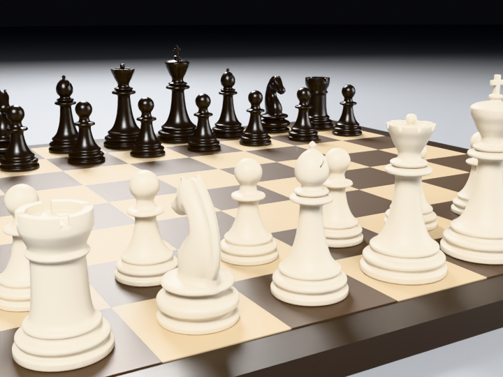

# Hangman

A Blender agent you talk to from Claude. You describe what you want, it runs tested Blender operations, measures
the result, and refuses to hand over anything that fails its checks.

It does not generate meshes or images with AI. Everything it makes is regular Blender geometry, materials and
renders that you can open and edit.



<sub>Every piece above was built from a text description (no reference photo), then measured: height, base
diameter, symmetry, watertightness, and the height order of the whole set. The knight uses the CC-BY 4.0
["A Beautiful Game"](https://github.com/KhronosGroup/glTF-Sample-Assets/tree/main/Models/ABeautifulGame) asset
(model (c) 2020 ASWF / MaterialX, glTF (c) 2022 Ed Mackey) as its base.</sub>

## Install

You need Blender 5.2 and Claude Desktop (or Claude Code).

1. Download the zip for your system from the [latest release](https://github.com/breakercreativelabs-collab/hangman/releases/latest):
   `windows-x64`, `macos-arm64`, `macos-x64` or `linux-x64`. Don't unzip it.
2. In Blender: **Edit > Preferences > Get Extensions**, open the menu in the top right, choose
   **Install from Disk** and pick the zip.
3. In the 3D viewport press **N**, open the **Hangman** tab and click **Install & connect to Claude**.
4. Quit Claude Desktop completely (tray icon > Quit) and start it again.

That's it. No Python install, no `uv`, no editing JSON by hand. The connector runs on Blender's own Python. Your
existing MCP servers in `claude_desktop_config.json` are kept, and a backup of the file is written first.

Files go to `Documents/Hangman` by default (change it in the add-on preferences).

## Try it

Ask Claude things like:

- "run diagnostics"
- "build a chess pawn"
- "build the full chess set on a board"
- "make a packshot of this bottle in red, blue and green, 16:9 and 9:16"

Keep Blender open while Claude works. The model shows up in your viewport step by step as it is being built, and the
last step is the exact mesh that gets saved. See [docs/en/LIVE_PREVIEW.md](docs/en/LIVE_PREVIEW.md).

## What it can do

| Module | What it does |
|---|---|
| `perakit` | Builds objects from a text description: Claude writes a shape spec (TOML), the agent turns it into a mesh and runs size, symmetry and manifold checks |
| `product_shot` | Studio packshots, turntables, color variants and aspect ratios |
| `modeling_referensi` | Models a real product from reference photos via measured contours |
| `tvc` | Short product animatics from a config file |
| `prosedural` | Procedural trees |

Each check comes with a negative test: a deliberately broken input that the check has to catch. A check that never
fails on broken input is treated as broken.

## How it works

```
You -> Claude -> MCP connector -> Blender (headless, in the background) -> files in your workspace
                                                                         -> your open Blender shows the steps
```

The open Blender only reads files from the workspace folder. Nothing listens on a network port.

## Other MCP clients

The connector is a standard MCP server, so Cursor, VS Code and other MCP clients can use it too. The one-click setup
only writes the Claude Desktop config; for other clients copy the same command from your Claude config
([docs/en/CONNECTOR.md](docs/en/CONNECTOR.md)). It is
tested with Claude. Results depend a lot on the model, since the hard part is writing a good shape spec.

## Usage stats

To get better over time, the agent sends anonymous numbers after each job: version, OS, command name, duration,
which checks passed or failed (check ID and value), the error type if it crashed, and the Good / Not good rating
you click in the panel.

It never sends file or project names, paths, prompts, images, meshes or any free text. The server doesn't store IP
addresses. Turn it off any time with **Turn off** in the panel, or by setting `AGEN3D_TELEMETRY=0`.

The numbers are reviewed every day. A change is only released when it passes the full test suite and a fixed
benchmark and doesn't make anything slower or worse; data that looks like spam from a single install is dropped.

If you'd rather describe a problem in words, open an issue with the
[feedback template](https://github.com/breakercreativelabs-collab/hangman/issues/new?template=kiriman-belajar.yml). Details:
[docs/en/FEEDBACK.md](docs/en/FEEDBACK.md).

## Known limitations

- Organic shapes (animals, characters) built from scratch don't look professional yet. For those it adapts openly
  licensed models and checks their quality first.
- Surface detail is lower than AI mesh generators. That's the trade-off for exact sizes and editable geometry.
- Needs Blender 5.2 (the bundled Python packages are built for its Python 3.13).
- Final renders want a GPU. CPU works, slowly.

## License

GPL-3.0-or-later. See [LICENSE](LICENSE).
